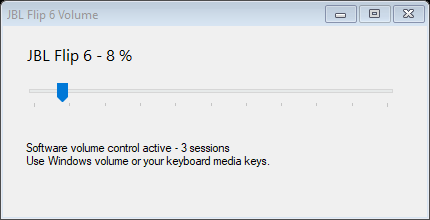
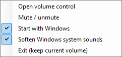

# JBL Flip 6 USB Volume

**Make Windows volume controls work with your JBL Flip 6 over USB.**

A portable Windows utility for speakers recognized as **Zgmicro AUDIO**, with a system tray volume control, media-key support through Windows, and quieter system sounds.

If your speaker plays at full volume even when Windows shows 0%, this utility mirrors the Windows volume setting to the audio sessions playing through that device. It includes a system tray control and an option to soften Windows system sounds.

## Features

- Adjust application audio with the Windows volume slider or keyboard media keys.
- Open a dedicated volume slider from the system tray.
- Soften Windows notification and system sounds independently of application audio.
- Optionally start the utility when you sign in to Windows.
- Run as a portable executable, with no driver or firmware installation.

## Screenshots

### Volume control

The app shows the current Windows volume and the number of audio sessions it manages.



### System tray menu

Open the slider, toggle mute, manage startup, soften system sounds, or exit from the tray menu. The checked options below reflect the settings used when the screenshot was taken.



## Download and run

1. [Download JBLVolume.exe](https://github.com/Insthic/jbl-flip6-usb-volume/raw/refs/heads/main/JBLVolume.exe).
2. Save it to a writable folder and run it with your speaker connected as Zgmicro AUDIO.
3. Adjust the Windows volume, use your keyboard's media keys, or open the app's volume slider.

Double-click the tray icon to open the window. Closing the window hides it in the tray. **Exit (keep current volume)** stops the utility without restoring potentially loud previous levels.

The tray menu includes **Start with Windows** (off by default) and **Soften Windows system sounds** (on by default: system sounds use 5% of the main volume level).

## Requirements and compatibility

- 64-bit Windows 10/11 with .NET Framework 4.8.
- A USB-connected speaker recognized as **Zgmicro AUDIO**. The app searches by name and refuses an ambiguous selection if multiple matching devices are connected.
- No administrator privileges, REA, Ghidra, Java, or Node.js are required to run the utility.
- Tested on one PC with a JBL Flip 6. The user confirmed that application volume control works. The later system-sound adjustment was verified by reading session levels; its acoustic output was not measured.
- Other PCs and JBL models have not been tested.

## How it works and limitations

The app reads the Zgmicro endpoint's `IAudioEndpointVolume` and adjusts its sessions through `ISimpleAudioVolume` approximately every 30 ms. Applications use the full 0-100% range by default. Deliberate per-application mixer adjustments are saved separately using the application's session identifier, rather than the identity of one process instance. Restored Windows mixer levels are never treated as new relative preferences.

**Restart fix:** older versions could mistake an already reduced session level for a new baseline, limiting an application to 20% or multiplying the attenuation again after a restart. The updated version ignores that legacy state. On the first upgrade with an active audio session, it may lower the main Windows volume to preserve the current listening level; raise it normally afterward to use the full range.

This works with the Windows shared audio mixer. Applications using WASAPI exclusive mode or ASIO may bypass it. A new session may produce sound before the next adjustment cycle: **this utility is not a safety limiter**. It does not control the speaker's physical volume or modify its firmware.

The default audio output is left unchanged. If USB is disconnected, the app waits for reconnection. Only Zgmicro sessions are managed; application mixer levels may change while the utility is running.

To move the app to another PC, copy **only the executable**, without `session-levels.tsv` or `application-levels-v2.tsv`. Diagnostics and state are stored locally and are never uploaded. The legacy file is retained for recovery but no longer used.

## Build from source

Run this command in PowerShell from the project folder:

```powershell
powershell -NoProfile -ExecutionPolicy Bypass -File .\build.ps1
```

The script uses the .NET Framework compiler included with Windows and downloads no dependencies. It produces `JBLVolume.exe`.

Run the volume regression tests without changing any real audio levels:

```powershell
powershell -NoProfile -ExecutionPolicy Bypass -File .\tests\run.ps1
```

To generate a read-only diagnostic report:

```powershell
.\JBLVolume.exe --diagnose
Get-Content .\diagnostic.txt
```

## Uninstall

Disable **Start with Windows**, exit using the tray menu, and delete the app folder. No driver is installed.

## Investigation

Windows identified the Microsoft USB Audio class driver used by the device; that file was inspected with REA 6.7.0 and Ghidra 12.1.4. This inspection did not establish the exact firmware-level cause. Audio API measurements showed a main volume of zero while independent sessions remained at full volume; this workaround attenuates those sessions.

References: [endpoint hardware controls](https://learn.microsoft.com/en-us/windows/win32/api/endpointvolume/nf-endpointvolume-iaudioendpointvolume-queryhardwaresupport), [session volume](https://learn.microsoft.com/en-us/windows/win32/api/audioclient/nf-audioclient-isimpleaudiovolume-setmastervolume).

Independent project, not affiliated with JBL, Harman, or Microsoft. Source code is licensed under MIT. The executable is unsigned.
